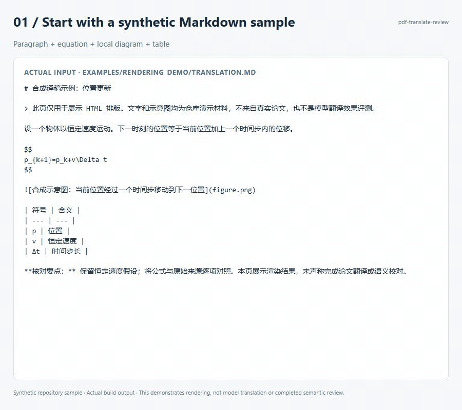
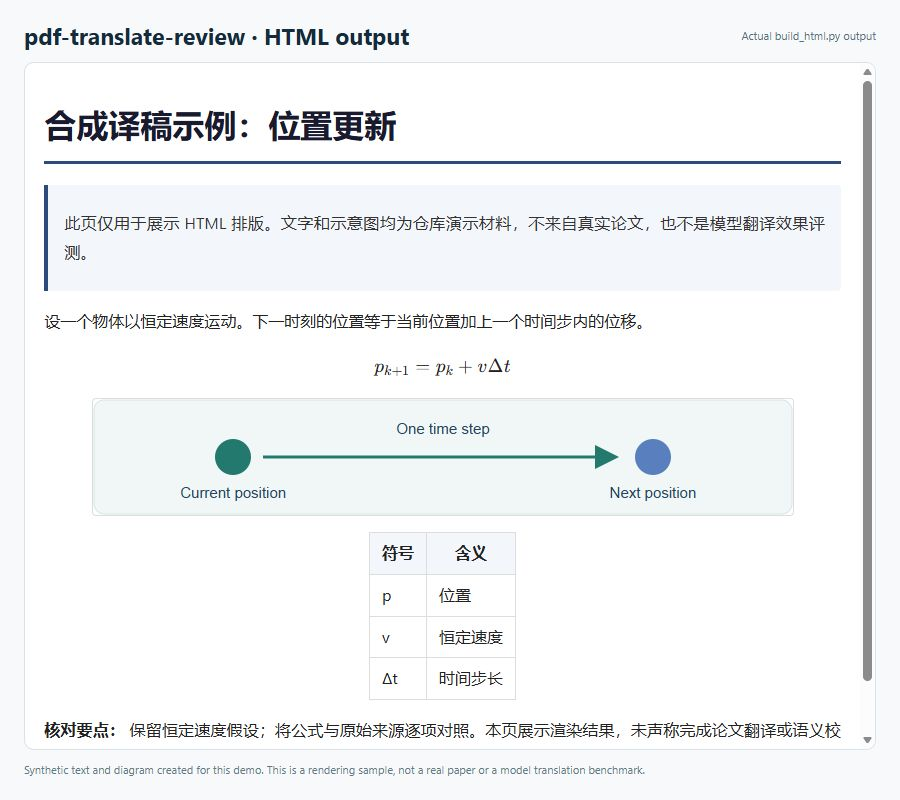

[简体中文](README.md) · **English**

# PDF translation with source-aligned review

Turn an academic PDF into a Chinese translation with original figures, tables, and equations, then review it against the source and optionally build a self-contained HTML file. This repository contains agent skills and local tools; the agent performs translation and semantic review.

[Try a sample](#try-without-a-paper-or-model-account) · [Translate a paper](#translate-your-first-paper) · [Report a problem](https://github.com/Marco0431/pdf-translate-review/issues/new?template=bug_report.md) · [MIT license](LICENSE)

## See the output

This synthetic sample was rendered by the repository's existing HTML build script. It shows a paragraph, equation, diagram, and table. The text and diagram were created for the demo; this is not a full-paper model translation benchmark.



<a href="docs/media/pdf-render-overview.jpg"></a>

[Full-size still image](docs/media/pdf-render-overview.jpg) · [Sample and reproduction commands](examples/rendering-demo/README.md). Successful rendering does not establish translation accuracy or complete source-aligned review.

## Choose an entry point

| Goal | Start here |
| --- | --- |
| Translate one paper with detailed figure and equation checks | [Single-paper skill](SKILL.md) |
| Translate multiple papers, resume interrupted work, or archive to Zotero | [Batch skill](skills/paper-translate-html/SKILL.md) |
| Render an existing Chinese Markdown translation | `scripts/build_html.py`, after installing Node.js dependencies |
| Ask questions while reading in Zotero | [AskGPT](https://github.com/Marco0431/askgpt-zotero), a separate plugin |

The detailed skill instructions and verification guide are in Chinese. “Review” means checking the translation against its source, not academic peer review.

## Try without a paper or model account

With Git and Python installed (tests use Python 3.12), run:

```sh
git clone https://github.com/Marco0431/pdf-translate-review.git
cd pdf-translate-review
python skills/paper-translate-html/scripts/translation_workbench.py packet --stage review --document skills/paper-translate-html/tests/fixtures/translation-case.json --translations skills/paper-translate-html/tests/fixtures/translation-good.json --out review-demo.json
```

Open `review-demo.json` in a text editor. It contains five source units and their translations, with contextual terminology and source evidence. The synthetic sample distinguishes a control *policy* from a safety *policy* and retains the limitations of simulated results. This command prepares review material; it does not call a model or complete a review. No third-party Python packages are needed for this sample.

## Translate your first paper

1. Use an agent that can read `SKILL.md`. Point it to this repository's [single-paper skill](SKILL.md), or install the entire repository in that agent's skills directory. The batch skill also needs the shared scripts in this repository.
2. Install the PDF extraction dependencies. Run the following from the repository root:

   ```sh
   python -m pip install pymupdf pymupdf4llm
   ```

3. Give the agent a local PDF and an output directory, for example:

   ```text
   Use pdf-translate-review to translate ./paper.pdf into Chinese in ./out/.
   Keep every section, original figure, equation number, and table.
   Compare the translation with the source and report unfinished checks.
   Also produce a self-contained HTML file for offline reading.
   ```

4. For HTML output, install Node.js dependencies in the directory containing `package.json`:

   ```sh
   npm install
   python scripts/build_html.py out/translation.md out/translation.html
   ```

   The Markdown input must already exist; this command renders it rather than translating the PDF. Local images resolve relative to that Markdown file. HTML browser checks additionally require Microsoft Edge or Google Chrome.

The agent account and model service determine translation costs and how paper data is processed. Offline HTML refers to the delivered document, not an offline translation model. Zotero archiving is optional; use it only when you intend to write the resulting attachment.

## Know when the work is ready

Check that all sections, tables, captions, figure slots, and equation numbers are present. Equation syntax checks cannot prove mathematical fidelity, and text extraction may lose symbols. Compare equations and figures with rendered source pages and inspect the final HTML. The [Chinese walkthrough](README.md#两条产出流水线) lists the commands, and the [verification guide](reference/verification-guide.md) explains their limits.

Common setup problems:

- **A Python module is missing:** install the PDF dependencies with the same `python` used to run extraction.
- **A Node.js module is missing:** run `npm install` in this repository, not in the paper's output folder.
- **An image is missing in HTML:** check its path relative to the Markdown file and inspect the build warnings.
- **A translation check says `needs_review`:** source-aligned semantic review is still required; a structural pass does not finish it.

## Feedback and contributions

[Report a problem](https://github.com/Marco0431/pdf-translate-review/issues/new?template=bug_report.md) with the command, operating system, Python / Node.js versions, expected result, and error. Include a page number and a small shareable excerpt for figure or equation problems. Do not upload private papers, Zotero data, or credentials.

Useful contributions include reproducible layout cases, contextual terminology examples, and clearer installation instructions. For changes to batch tools, run:

```sh
python -m unittest discover -s skills/paper-translate-html/tests -v
```

See the [documentation index](llms.txt) for the remaining tools. Code is distributed under the [MIT license](LICENSE).
